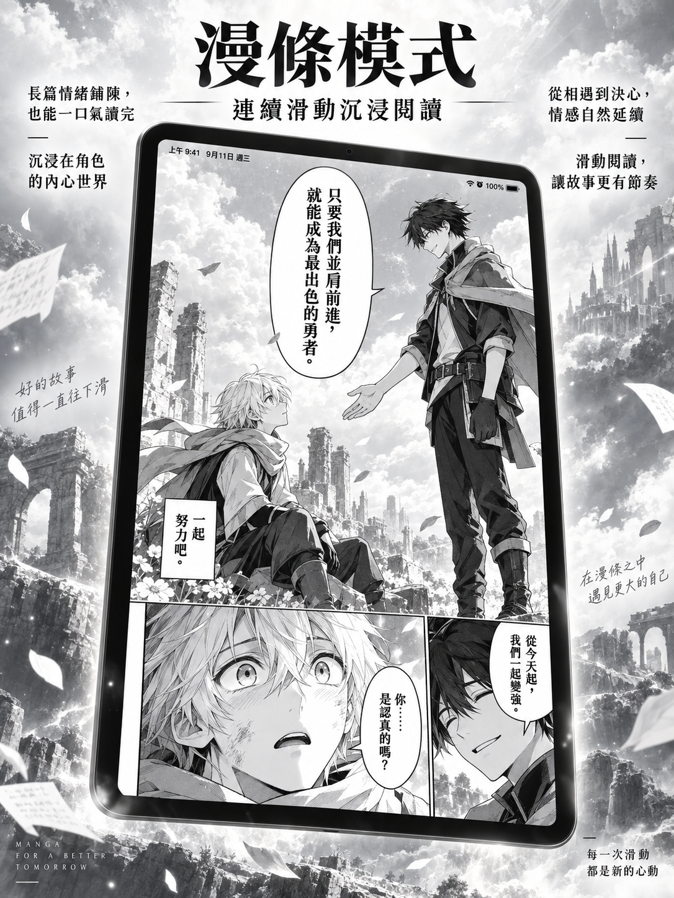
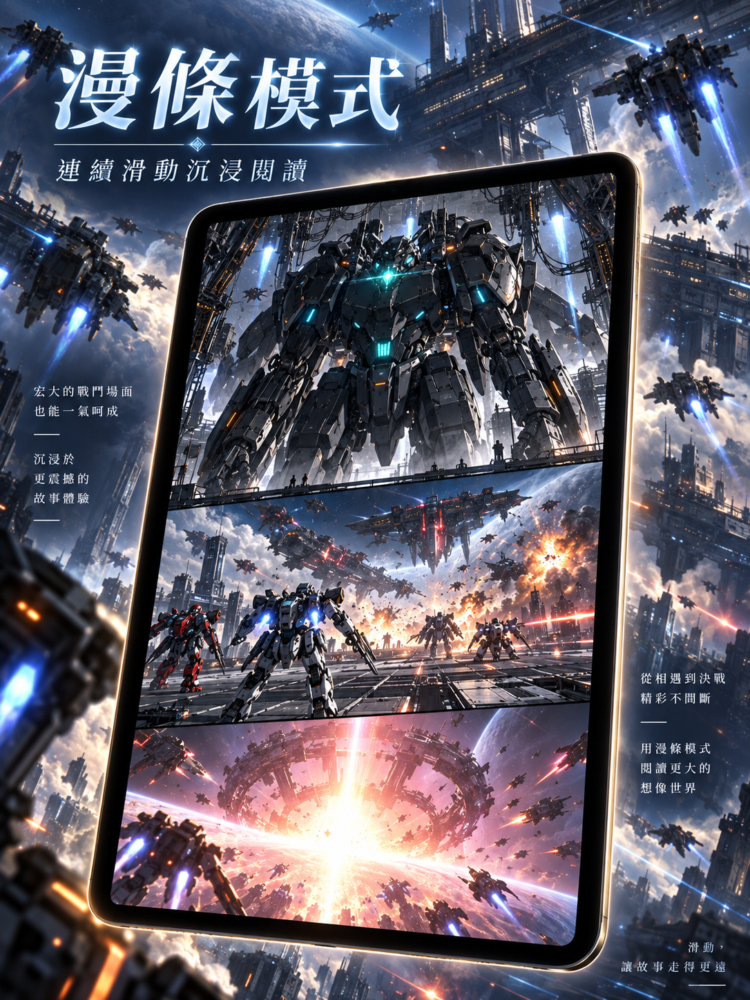
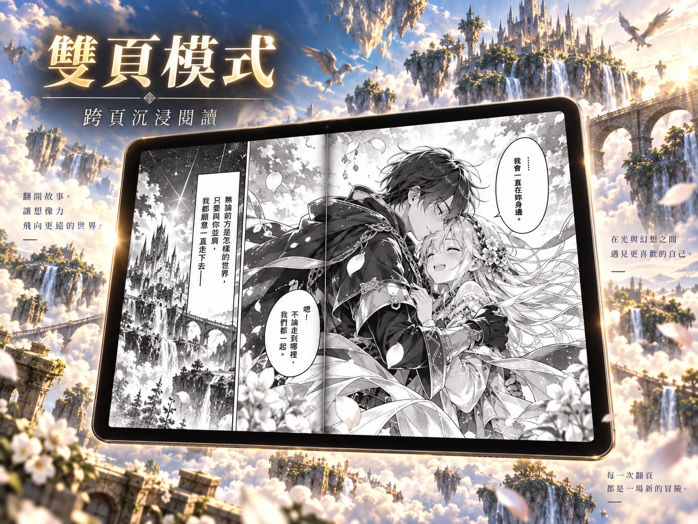
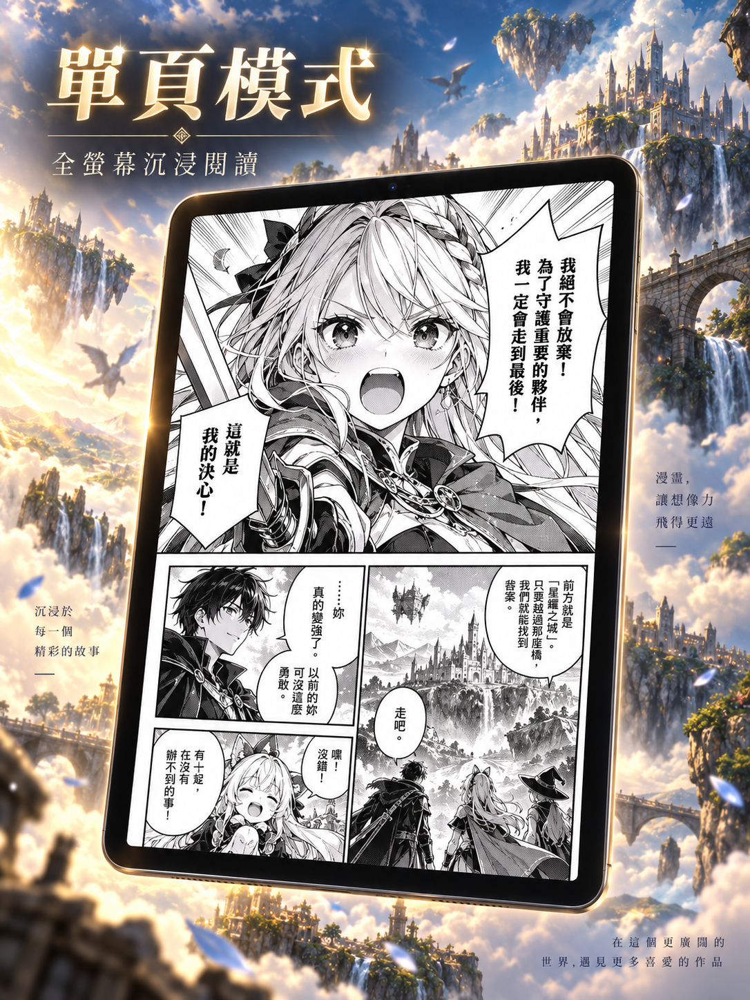
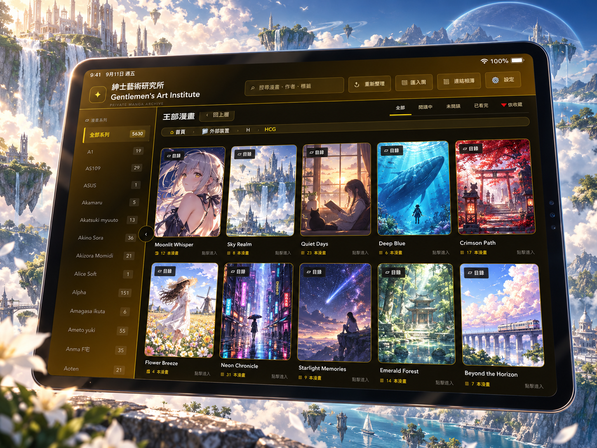
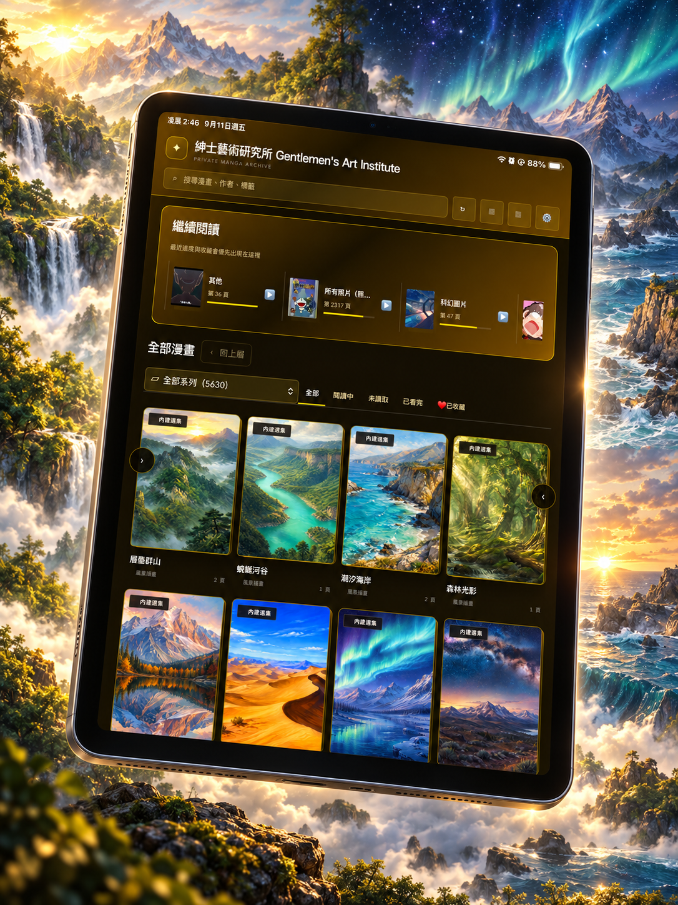

# G.A.I 宣傳概念圖

這七張是以 G.A.I 真實畫面構圖製作的 **AI 宣傳圖**，替換了示範漫畫與封面內容，並加入背景與文案。第六張保留較早期的書庫介面，僅供站外宣傳參考；第七張與目前介面相近。**圖中的漫畫與封面不是 App 隨附內容**。G.A.I 只讀取使用者自己提供、且有權使用的本機／外接硬碟／NAS 圖片與 ZIP／CBZ、RAR／CBR、7z／CB7。

商店展示仍要讓人認得出真實功能與目前可用的介面；閱讀畫面可用這組宣傳構圖說明，但不把置換後的漫畫內容說成隨 App 提供。

2026-09-28 已將原圖等比例放大至 iPad 13 吋商店尺寸（直向 2064 × 2752、橫向 2752 × 2064），上傳到 App Store Connect 的 `zh-Hant` iOS 1.0 截圖組。核對目前介面後，已從商店截圖組移除展示舊書庫介面的第六張；其餘六張與原有實機截圖均回報 `COMPLETE`。商店文案明確說明 App 不附漫畫。此處保留使用者交付的七張原圖，避免把放大後的上傳產物重複提交到 Git。

## 條漫閱讀

## 雙頁與單頁閱讀

## 書庫氛圍

